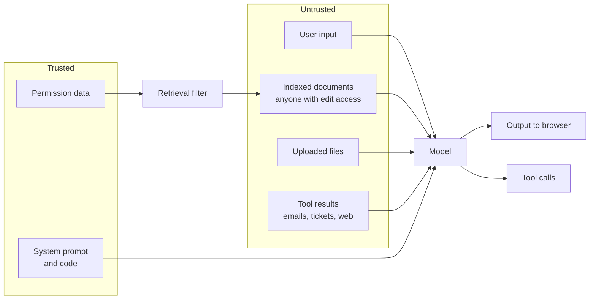

An AI assistant combines three things that are each risky on their own: broad read access to company data, the ability to take actions in other systems, and a component (the model) that follows instructions written in plain language, including instructions hidden in the data it reads. Security for this system is about making sure no single failure, especially a model being fooled, leads to a data leak or an unauthorized action.

## What is new

Traditional web application security still applies: authentication, injection, access control, secrets, dependencies. On top of that, AI systems add:

| New risk | Why it is different |
| --- | --- |
| **Prompt injection** | Untrusted text (documents, emails, web pages, user input) can change the model's behavior. There is no reliable way to escape it, unlike SQL injection |
| **Over-broad retrieval** | A search index copies data from many systems. If permissions are not copied correctly, the assistant becomes a way around them |
| **Model as a confused deputy** | The model acts with the user's permissions, but can be manipulated into using them for an attacker's goals |
| **Output as an attack vector** | Model output rendered in a browser can exfiltrate data through images and links |
| **Data in new places** | Prompts and outputs land in traces, logs, caches, eval sets, and provider systems |
| **Non-deterministic behavior** | A defense that works 99 times may fail on the 100th phrasing |

The OWASP Top 10 for LLM Applications is a useful checklist of these risks. This section covers how to defend against them in this architecture.

## Threat model

Everything in the untrusted box can contain attacker-controlled text. That includes internal documents: any employee, contractor, or compromised account that can edit a wiki page can plant instructions for the assistant.

### Actors

| Actor | Goal | Example |
| --- | --- | --- |
| Curious employee | See data they are not entitled to | Asking for salary data or another team's documents |
| Malicious insider | Exfiltrate data, cause damage | Planting injection in a widely read page |
| External attacker with a foothold | Use the assistant to move further | Sending an email with injected instructions to a user whose inbox the assistant reads |
| Other tenant (SaaS) | Access another customer's data | Probing APIs, caches, shared resources |
| Attacker targeting cost | Run up your bill or deny service | Scripted expensive requests |

### Assets

- Confidential documents and their permission boundaries.
- Conversation content, which often contains sensitive data users pasted in.
- Credentials for connected systems.
- The ability to act in those systems.
- Tenant isolation.
- The budget.

## Layered controls

No single control is enough. The design assumes the model **will** be fooled sometimes, and limits what a fooled model can do.

| Layer | Control | Stops |
| --- | --- | --- |
| Identity | SSO, short sessions, SCIM deprovisioning | Stale and stolen accounts |
| Data access | Permission filtering inside retrieval, tenant isolation | The model ever seeing data the user cannot access |
| Input | Injection classifiers, PII detection | Some attacks, early. Not reliable alone |
| Prompt | Clear separation of instructions and data, injection-aware instructions | Some injection. Not reliable alone |
| Actions | Read vs write tools, human confirmation for writes, narrow scopes, delegated tokens | A fooled model taking harmful actions |
| Output | Safe rendering, no external images, link checks, output filters | Exfiltration and harmful content reaching users |
| Limits | Rate limits, token budgets, agent step limits | Abuse and denial of wallet |
| Detection | Audit logs, anomaly alerts, red team canaries | Attacks that get through, noticed quickly |

The strongest controls are the ones that do not depend on the model behaving: **data the model never receives, actions it cannot take without a human click, and output the browser will not execute.**

## Pages in this section

| Page | Covers |
| --- | --- |
| [Access control](/docs/security/access-control) | Tenant isolation and document permissions end to end, and how to test them |
| [Prompt injection](/docs/security/prompt-injection) | Direct and indirect injection, and the defenses that work |
| [Data protection](/docs/security/data-protection) | Encryption, PII handling, secrets, and keeping sensitive data out of logs |
| [Infrastructure security](/docs/security/infrastructure) | Network design, provider security, supply chain, vulnerability management, and incident response |
