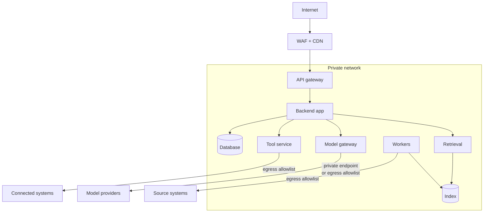

The AI-specific risks covered elsewhere in this section sit on top of ordinary infrastructure. A perfect prompt injection defense does not help if the database is reachable from the internet or a dependency is compromised. This page covers the infrastructure controls, with the parts that need special attention in AI systems.

## Network design

| Control | Detail |
| --- | --- |
| Only the gateway is public | Databases, the index, workers, and internal services have no public endpoints |
| WAF in front | Blocks common web attacks and absorbs volumetric abuse |
| Egress allowlists | Each component can only reach the external hosts it needs. The model gateway reaches model providers. The tool service reaches connected systems. Nothing else reaches the internet |
| Private connectivity to providers | Private endpoints or peering where the provider offers it |
| Segmentation | The tool service and workers run in their own network segments with their own policies |

**Egress control matters more for AI systems than for most apps.** If an attacker achieves code execution through a parser vulnerability in a malicious uploaded file, egress restrictions decide whether they can send data out.

## Isolating high-risk components

Two components process hostile input or hold powerful credentials, and deserve extra isolation.

### Document parsers

Parsers for PDF, Office, and image formats have a long history of vulnerabilities, and the assistant feeds them files from users and from any source system.

- Run parsing in **sandboxed workers**: separate containers with no credentials beyond reading the input and writing the output, no network egress, read-only file systems, and CPU, memory, and time limits.
- Treat parser crashes and timeouts as potentially malicious files, not just bugs. Log them.
- Keep parser libraries patched with high priority.

### Code execution

If the assistant can run code, for example for data analysis, run it in a strongly isolated sandbox: a microVM or gVisor-style container, no network by default, no access to internal services, strict resource limits, and destruction after each session. Never run model-generated code in the same environment as the application.

### Tool service

Holds credentials for other systems. Give it its own deployment, service identity, and secrets, and accept calls only from the orchestrator with a signed user context. See [Agents and tools](/docs/ai-model/agents-tools).

## Model provider security

Model providers are critical vendors that process your most sensitive data.

| Check | Questions |
| --- | --- |
| Certifications | SOC 2 Type II, ISO 27001, and sector-specific ones your customers need |
| Data usage | No training on your data. Retention period. Zero retention option |
| Region | Where data is processed and stored, including for abuse monitoring |
| Subprocessors | Who else touches the data |
| Access controls | Your API keys: scoping, rotation, project separation, usage monitoring |
| Incident notice | Contractual notification time for breaches |

Monitor your provider usage for anomalies. A sudden spike in token use from one API key can mean a leaked key.

## Supply chain

AI projects pull in many fast-moving dependencies: model SDKs, orchestration libraries, parsers, vector database clients, and sometimes model weights.

| Risk | Control |
| --- | --- |
| Compromised or typo-squatted packages | Lockfiles, a private registry mirror or proxy, dependency review in pull requests |
| Known vulnerabilities | Automated scanning (Dependabot, Renovate, Snyk, or similar) with patch SLAs |
| Malicious model weights | Download only from trusted sources, verify checksums, prefer `safetensors` over pickle-based formats, which can execute code on load |
| Container images | Minimal base images, scanning, signed images, admission policies that only allow signed images |
| Build pipeline | Protected branches, required reviews, least-privilege CI credentials, provenance attestation |

## Vulnerability management

| Severity | Patch target |
| --- | --- |
| Critical, exploitable, internet-facing | 48 hours |
| High | 7 days |
| Medium | 30 days |
| Low | Next regular update |

Include AI-specific findings in the same process. A reproducible prompt injection that leads to data exfiltration is a critical vulnerability, not a "model quality issue". Run a vulnerability disclosure program or at least publish a security contact, so researchers can report what they find.

## Abuse and cost attacks

- Rate limits and token budgets at several layers. See [Rate limits and quotas](/docs/backend/rate-limits).
- Bot protection on sign-up and public endpoints, if any exist.
- Alerts on unusual cost per user or tenant, and on spikes in total spend.
- A kill switch per tenant and per feature, so an abused integration or API key can be disabled in seconds.

## Incident response

AI incidents have some specific forms. Prepare runbooks for them in addition to standard ones.

| Incident | First steps |
| --- | --- |
| Data shown to an unauthorized user | Identify affected answers from logged document IDs. Fix or disable the failing connector or filter. Notify per your obligations |
| Prompt injection found in a source document | Quarantine the document from the index. Search for similar content. Find answers that used it |
| Leaked provider API key | Revoke and rotate. Review usage during the exposure window |
| Harmful output reported | Capture the trace. Add to the safety set. Adjust guardrails. Assess whether others were affected |
| Unauthorized tool action | Disable the tool. Review audit events for the action and similar ones. Reverse the action where possible |
| Model provider breach notice | Determine what data was sent in the affected window. Follow contractual and legal notification steps |

The ability to answer "which users saw content from document X" or "which answers used prompt version Y" quickly depends on the lineage described in [Schema and lineage](/docs/data/schema). Build it before you need it.

## Checklist

- [ ] Only the gateway is internet-facing.
- [ ] Every component has egress allowlists.
- [ ] Parsers run in sandboxed workers with no credentials or network.
- [ ] Any code execution runs in a strongly isolated sandbox.
- [ ] Model providers are reviewed as critical vendors, and API key usage is monitored.
- [ ] Dependencies, images, and model weights are scanned and verified.
- [ ] AI-specific vulnerabilities are handled in the normal vulnerability process with patch targets.
- [ ] Kill switches exist per tenant and per feature.
- [ ] Incident runbooks cover data exposure, injection, key leaks, harmful output, and unauthorized actions.
